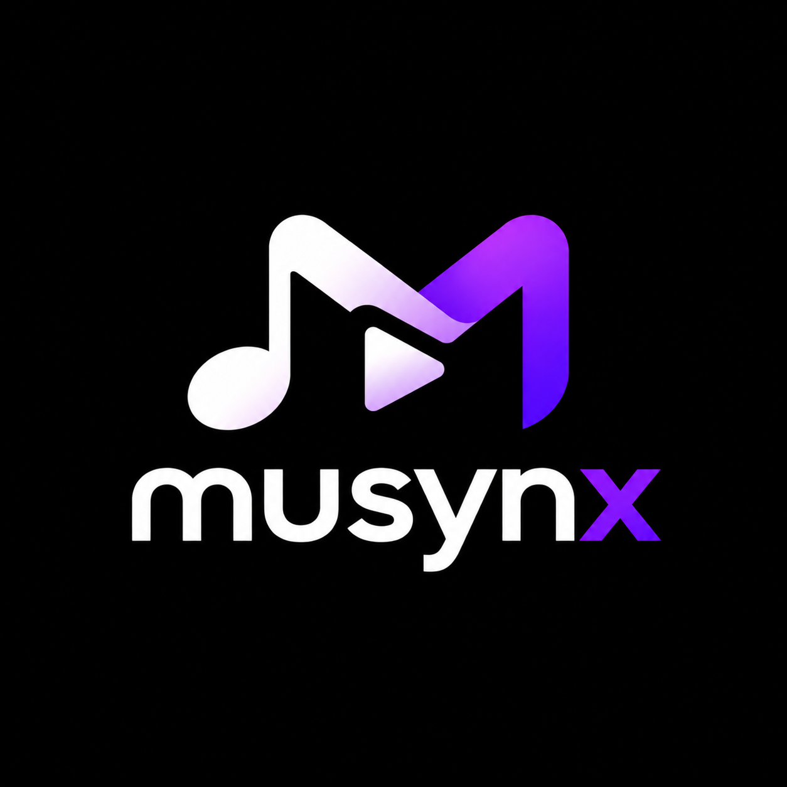

<h1 align="center">
   
  Musynx
</h1>

  <strong>A modern, minimalist YouTube Music client for Android.</strong> 
  <i>Built with Jetpack Compose, Material 3, and high-performance audio streaming.</i>

  
  
  
  
  

---

## Overview

**Musynx** is a feature-rich, open-source YouTube Music client designed by **Nitya App Studio** (Developer: Bhim Kumar Yadav). It offers seamless music streaming, lyrics support, offline downloads, smart caching, and a stunning Material 3 user interface.

---

## Features

* **Seamless Playback:** Stream high-quality music or enjoy local tracks with zero interruptions.
* **Background Playback:** Keep listening while multitasking or with your screen turned off.
* **Offline Downloads:** Download your favorite tracks for offline listening anytime.
* **Smart Caching:** Automatic caching for fast, stutter-free playback.
* **Powerful Search:** Discover songs, albums, artists, videos, and playlists directly from YouTube Music.
* **Real-Time Lyrics:** Fetch, view, and enjoy synchronized lyrics in real time.
* **Audio Controls:** Fine-tune audio with volume normalization, skip silence, and sleep timer.
* **AdMob Integration:** Integrated with high-performance AdMob banner ads.

---

## Installation & Releases

Get the latest stable or pre-release APKs directly from GitHub:
* [GitHub Releases](https://github.com/Bhim9839/Musynx/releases/latest)

---

## Credits & Inspiration

Musynx builds upon incredible open-source projects and creative resources:

* [**NewPipe**](https://github.com/TeamNewPipe/NewPipe)
* [**NewPipe Extractor**](https://github.com/TeamNewPipe/NewPipeExtractor)
* [**music-you**](https://github.com/DanielSevillano/music-you)
* [**ViMusic**](https://github.com/vfsfitvnm/ViMusic)
* [**RiMusic**](https://github.com/fast4x/RiMusic)
* [**InnerTune**](https://github.com/z-huang/InnerTune)
* [**ViTune**](https://github.com/25huizengek1/ViTune)
* [**OuterTune**](https://github.com/OuterTune/OuterTune)
* [**Symphony**](https://github.com/zyrouge/symphony)

---

## License

Musynx is licensed under the **GPL-3.0-only** License.
